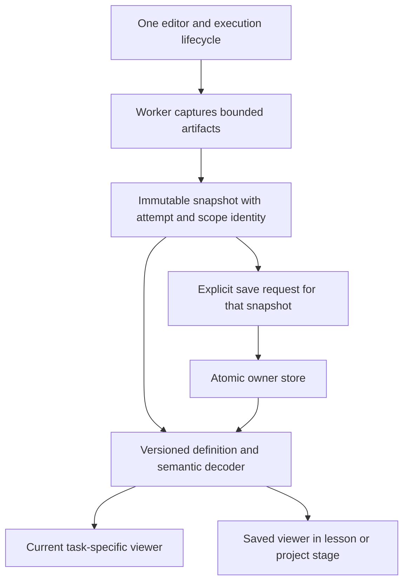

# Result inspection design review and implementation sequence

Date: November 6, 2026. Design handoff and local pilot implementation record.

The feature lets learners inspect what their code produced within the crew's
ongoing task. Shared capture, result identity, and recovery support a suitable
view for each lesson. Story passages, original artwork, the five-section
layout, meaningful choices, and earned epilogues remain the product's frame.

This review develops the five steps discussed with the owner. The
[main specification](../specs/2026-11-06-story-driven-result-inspection.md)
records the product contract. Detailed workpapers resolve different questions:

| Question | Research artifact |
| --- | --- |
| What does every lesson need? | [56-lesson mission map](../../design-previews/research/deep-orbit-result-map.md) |
| What can each exercise actually support? | [65-exercise contract matrix](../../design-previews/research/result-contract-matrix.json) and [coverage review](../../design-previews/research/lesson-result-design-review.md) |
| What must evaluation capture and verify? | [Evaluation result contract](../../design-previews/research/evaluation-result-contract.md) |
| What happens across runs, edits, saves, restores, and account changes? | [Result lifecycle contract](../../design-previews/research/result-lifecycle-contract.md) |
| How does the experience fit the story and each task? | [Lesson storyboards](../../design-previews/research/result-experience-storyboards.md) |

The workpapers refine the first-pass audits. Where an earlier proposal differs,
the precise contracts and decisions in this review take precedence. None of
these research workpapers claims observed learning gains. Local implementation
progress is recorded separately below.

## Implementation progress on November 6

Step 1 now has an implemented recorder, capture adapter, semantic decoder, and
evaluation grader. The worker and CLI share the capture implementation. The
grader publishes a validated four-table report before checking the learner's
diagnosis. Safe final measurements remain available when procedure checks fail.

The recorder preserves immutable loss/accuracy observations and bounded weight
copies. Weighted-layer identity keeps prior fits visible across Sequential
recompilation. Recompiling an unchanged model remains valid. Independent model
history, extra fitting on shared weights, custom metrics, mutable returned
history, and replaced public measurement methods cannot obtain the supported
procedure claim through the tested paths.

The shared decoder validates the exact 38-row context and all 43 cases, checks
source and metric consistency, and returns partial/unavailable states without
inventing values. It runs without importing TensorFlow. When learner output
already occupies a slot, capture preserves that output and gives a specific
failed check explaining how to make room for the evaluation report.

Validation records:

- 16 evaluation worker regressions pass, including valid alternatives and
  deliberately incorrect procedures.
- 20 shared fixture/decoder tests pass, including actual worker captures.
- 15 recorder tests pass. All 11 existing runner cases passed across the
  full run and the focused backend-setup rerun after its compatibility fix.
- All 65 exercise solutions pass through the shared worker and their starters
  fail to pass the whole suite. The evaluation also passes the CLI solution,
  starter, and cheat checks.
- Shared and UI package type checks pass. The repository-wide type check
  reports errors in unchanged API/content/test files. Those diagnostics remain
  outside this slice. Targeted lint has no errors and retains the existing
  unused `TF_MOCK` warning in the runner.

The implementation uses frozen plain number arrays for accessible checkpoints.
The updated contract records their bounds and memory limits. Scene content,
artwork, recall, and epilogues retain their existing behavior.

Steps 2 and 3 are now integrated locally:

- The shared exercise owns one editor and emits tokened start, capture, and
  invalidation events. It renders the current result before saved history.
  Snapshot callbacks remain once per accepted completion. Restore registrations
  reject stale editor instances and preserve recovery before replacing code.
- Normalization and network explanations appear immediately after a run.
  Evaluation uses a responsive score plot with exact horizontal positions,
  supplied-label lanes, generated/authored source marks, category selection,
  keyboard-accessible case selection, and captured input values. Shared prose
  typography now supplies defaults below authored component utilities, preserving
  22px lesson text and readable control/supporting-text sizes. Saved and current
  views use equal width on small screens. Partial and inconsistent records retain
  safe cases without unsupported whole-run claims.
- Starting another run retains one useful earlier report in a closed disclosure.
  Reset and account/exercise changes invalidate delayed preparation. Editing
  labels the result's source as older code. Current and retained previous results
  share identity with their saved copies, preventing duplicate charts.
- Save/delete state tracks the affected run separately from execution. A committed
  write followed by a failed refresh reports that distinction. A failed read does
  not masquerade as an empty history. One saved detail opens at a time.
- Frozen historical descriptors preserve normalization and network records. The
  evaluation reader accepts the supported captured contract. Creation/download
  and reading work with evaluation writes disabled. The store enforces
  `NEXT_PUBLIC_EVALUATION_SAVES_ENABLED=true` before opening a write transaction.
- Project stages contain their matching local histories alongside separately
  labeled practice/review records. Paid network and evaluation source resolution
  remains entitlement-gated on the server; clients receive starter code and
  hashes, never authored grading or solution source from the project page.

The reader-first rollout flag defaults to false in `apps/web/.env.example`.
Deploy compatible readers first, establish that build as the oldest supported
rollback target, then enable evaluation writes in a later build. Disabling
writes must keep the reader deployed. Old already-open incompatible tabs remain
subject to the documented reload limitation. No deployment was performed here.

Final focused commands currently pass: 96 runtime/decoder/recorder/store tests,
78 shared UI and saved-history/project tests, 100 project/lesson integration and
story-layout tests, and 27 result-viewer tests. These command groups overlap;
the counts are not additive. A real Chromium IndexedDB probe covers write
flag refusal, concurrent milestone saves, reading after write-flag rollback,
delete/owner isolation, and atomic capacity refusal. The current web, UI, and
shared package type checks pass. Targeted web lint has no warnings. The content build
passes. No learner study or learning-gain claim follows from these checks.

Browser verification uses the production components, styles, TFJS worker,
semantic decoder, and IndexedDB on a loopback-only fixture. The reproducible
command is:

```sh
pnpm exec playwright test --config e2e/evaluation-result.config.ts
```

All eight browser cases pass. Evaluation is checked at 1440px, 390px, and 320px
in dark and light. Normalization and network training also pass actual capture,
save, and reload checks at 390px. The tests
cover actual capture, stable selection, current/saved identity, a failed retry,
opening and focusing the retained previous run, reload parity, no horizontal
overflow, and scoped WCAG A/AA axe checks. Current and saved screenshots are
written under `test-results/evaluation-result-browser/` and visually reviewed.
All eight scoped axe scans pass, with no page errors, external requests, or
horizontal overflow. The network score list now uses valid definition-list
structure. The browser fixture posts no assessment credit. Root React typings
were added for the browser fixtures using the already locked versions. The
repository-wide typecheck still reports 38 diagnostics in existing files; the
changed/new feature files have no diagnostics.

The subsequent signed-in review started the existing isolated Colima profile,
prepared local Supabase, and refreshed the source snapshot. The earlier stopped
Docker environment is no longer a blocker. Actual email sign-in, paid and unpaid
routes, all five phases of the three pilot lessons, and local history now have
live-route checks. The retained suite and local writer opt-in are documented in
[the review setup](../../review-setup.md#signed-in-lesson-review). No production
service was used for this review.

Keyboard testing covers Tab and Enter on controls and real button navigation.
The native select uses Playwright selection because this machine's headless
macOS Chromium did not apply ArrowDown/Enter even to a standalone native select.
Human screen-reader testing and observed learner understanding remain open
release evidence.

### Signed-in lesson review on November 6

The dedicated suite contains 27 serial Chromium cases: eight complete flows for
each pilot lesson at 1440, 1024, 390 and 320px in dark and light, plus unpaid
access, the paid evaluation prerequisite, and normal-motion story playback.
Tests use actual local email sign-in and verify the resulting account identity.
Fixture setup completes prerequisite modules in the isolated database. It does
not represent a learner completing those modules.

All 27 cases passed. After the final network bar-color correction, four targeted
flows also passed on a refreshed snapshot: network at 1440px dark and 320px light,
and evaluation at those widths/themes with saving disabled. The latter checks
confirm that actual result inspection and download remain available in the
default reader mode. The local app is left in that default mode. Screenshots are
retained in `test-results/signed-in-final/` and
`test-results/signed-in-final-reader/` and were visually reviewed.

The flows cover Briefing, Concept experiments, failed and solution-assisted
exercise runs, actual captured values, saved history, restoration that preserves newer drafts,
recall feedback, and earned epilogues. Evaluation also covers exact current and
saved JSON downloads, the project entry, sign-out and account return, deletion
across reload, the policy-cost decision, and assignment download/report recovery.
The independent assignment remains a draft. No independent model experiment or
learning achievement is claimed. Mobile sign-out uses Menu, Settings, Account.

Review fixes:

- Saved-history metadata now retains its intended 14px type while result prose
  remains 16px and story prose retains the shared lesson scale.
- The normalization preview no longer claims the network understood five
  readings. It states that its scores need evaluation against known labels and
  preserves sample 7741's unknown true label. Model data and thresholds remain
  unchanged. Two sentence-capitalization errors were also corrected.
- Categorical charts show every label and value in horizontal rows. Continuous
  frequency bins retain the compact series plot. Signed bars retain a visible
  zero baseline without a colliding interior tick label.
- Chart comparisons use compatible quantities. Evaluation scores remain
  separate from category counts, and normalization methods retain distinct
  units. Explicit scale groups preserve intentional comparisons in training,
  forecasting, signal processing, attention, gating, weight transformations,
  Kalman updates and WebGPU timing. The review inventoried all 37 numeric
  investigations and checked the shared flow diagrams. Calculations are intact.
- Captured-output chart colors use the existing world theme variables. The
  palette regression checks all eight series against three surfaces in all five
  worlds and both themes. Browser checks measure the rendered training-loss
  stroke and legend against the actual surface. The untrained comparison model's
  bar also now uses a defined theme color. Its opacity, contrast and score
  fraction pass real browser checks.

The shared chart regressions pass 102 focused tests, and the captured-output
palette suite passes five. The local review launcher passes nine safety and
configuration tests. Web and UI package type checks pass. The root TypeScript
check retains 38 existing diagnostics with none in these review or chart files.
The dedicated browser config is excluded from ordinary parallel test discovery.
Its helpers require the local endpoint, one worker, and disabled auth recording.

Remaining evidence and minor observations:

- This is Chromium viewport testing, not physical-device or other-engine
  validation. Scoped automated accessibility checks do not replace a human
  screen-reader review or observed learner understanding.
- Timed story scenes provide Skip intro and Replay scene, but no pause or
  control for advancing one beat at a time. The GitHub notice after the first
  solved exercise briefly covers nearby content and can be dismissed. A narrow
  Concept-cell selection marker can wrap within its cell.
  These existing behaviors remain visible review findings.
- Evaluation writing still defaults off for release. The local writer opt-in
  does not change the reader-first deployment requirement. No deployment,
  production purchase, external GitHub push or learner study occurred here.

## Step 1: reliable evaluation evidence

The interface needs to distinguish an incorrect diagnosis from useful measured
output. It also needs enough captured data to explain a case without rerunning
the model or reconstructing its inputs from today's fixture.

### Findings that change the implementation

Pinned TensorFlow.js probes show that the current evaluation checks accept
edited final training accuracy, changed weights after fitting, and an
overridden `evaluate()` returning fabricated metrics. Object identity alone
does not establish the weight state or preserve a mutable training history.
These are distinct from ordinary low model accuracy.

The proposed recorder copies bounded training observations and a supported
model's completed-fit weights. The grader measures the final model through
retained implementation references, checks state before and after measurement,
and reports whether that state matches fit completion. Changed weights can
still produce inspectable final-state measurements. Their training comparison
needs a visible limitation. The contract remains a diagnostic aid within the
supported runtime, without claiming secure attestation of arbitrary JavaScript.

### Architecture decision

Keep the current worker and artifact wire version. Use four bounded artifacts:
measured metrics, a typed Run context table, 40 generated cases, and three
authored cases. Validate both structure and meaning. The context records
explicit statuses and versions. It cannot infer machine fields from prose.

Copy actual inputs, labels, predictions, and metrics during the same supported
final-state measurement. Record them in a guarded synchronous phase before
registering the grader's checks. Its microtask/Promise.all harness does not make
test order a capture dependency. Copy the submitted diagnosis before invoking
its function.
Validate canonical fixture membership independently of learner variables.
Preserve unknown or mismatched provenance honestly. Retain strict
`score > 0.5`, complete case identity, and count/metric agreement.

Capturing only aggregate accuracy would leave errors unexplained. Replaying a
saved model would add weights, runtime compatibility, latency, and different
storage requirements. Captured bounded case data answers this lesson's question
without those dependencies.

### Exit evidence

Before connecting this report to a visual, the implementation must demonstrate:

- Valid measured output survives a wrong diagnosis.
- Mutable history, wrong-model history, post-fit weight changes, and overridden
  evaluation methods cannot acquire unsupported measured/provenance labels.
- Missing, duplicated, reordered, or changed rows follow the documented case
  identity and source rules. Valid training-pair reordering remains allowed.
- Extra fitting, held-out-row observations, recorder overflow, and unsupported
  operations produce explicit statuses within the bounds.
- Scores at exactly 0.5 follow the configured rule. Counts agree with metrics
  within the specified tolerance. No fixed accuracy or error count is required.
- Tensor cleanup disposes owned temporaries and preserves model-owned variables.

The workpaper supplies the exact schema, capture order, and runtime probe
results. These exit checks describe future implementation acceptance.

Adopt its 38-row typed context, omitted empty partitions, and bundle preflight.
Custom callbacks make the initial training-log observation unsupported because
they can change epoch logs before History records them. Agreement with measured
evaluation values does not prove that the learner called the API. Keep those
limits visible in developer contracts and the relevant learner explanation.

## Step 2: immediate inspection in three complete lessons

Normalization and the network exercise already have useful explanation code,
but learners reach it through saved-run disclosures. Move the explanation to
the current run and retain one implementation of each viewer. Add evaluation
after its evidence contract works.

### UX decision

Keep the result full-width after the editor and concise check verdict. Put
source limits beside the data. Saving and history follow. Use the authored
story's question to choose the main visual:

- Normalization follows one reading and feature through captured statistics.
- Network construction compares the same input across captured model states.
- Evaluation connects a score, supplied label, decision rule, and mistake.

The [storyboards](../../design-previews/research/result-experience-storyboards.md)
specify all five sections, control behavior, and copy boundaries. Keep existing
Concept experiments separate from executed reports. Selection changes the
view of captured evidence. A new experiment requires a deliberate code run.

### Integration decision

`Exercise` owns execution lifecycle and immutable raw snapshots. It exposes a
result render slot and explicit start/reset/restore/scope lifecycle events. A web-owned
definition selects the decoder and viewer. The shared UI package does not own
world semantics, storage, or account policy.

Use one existing Sandpack provider. A command registration guarded by draft
key, active scope/instance token, and registration ID connects restore to the
result footer. Cleanup removes only its own registration. Keep the generic output fallback for
unsupported or unadapted artifacts. Do not mount another activity to obtain
access to editor state.



A run token and scope epoch invalidate late capture. Code edits mark the
submitted source stale. A new attempt may retain one closed Previous run until
it produces useful output. Reset and scope change clear transient work.
An explicit save of A may finish while B is current without changing B's result
or labeling B as saving.

### Exit evidence

Review the actual full lessons, including artwork, dialogue, editor, help,
checks, result, decisions, recall, and epilogue. Cover correct work, useful
incorrect work, a failed rerun, reset during capture, rapid reruns, and edits
during asynchronous capture. Confirm one activity mount, one check announcement,
unchanged completion behavior, and usable code/result navigation on a phone.

## Step 3: saving, restoration, and return through the project

Retain first/latest explicit saves for Data, Model, and Evaluation. Course-wide
inspection remains possible without storing full source for every exercise.
The existing 2 MiB owner budget cannot support two maximum-size snapshots for
all 65 exercises.

### Storage and compatibility decision

Resolve the authenticated or guest owner synchronously from its actual scope.
IndexedDB loading state must not create a substitute identity. Keep a save's
immutable owner and run identity through its transaction. Report transaction
commit separately from history refresh. A refresh failure cannot turn a
successful save into a false claim that nothing was saved.

Freeze existing normalization/network readers. New evaluation records remain
within snapshot schema 1, but that alone does not make older bundles compatible.
The current store rejects any unknown milestone across the whole owner.
Deploy compatible readers before enabling evaluation writes and keep rollback
at or above that reader release. Long-lived older tabs still need an explicit
compatibility treatment described in the lifecycle contract. A feature flag
cannot make an already loaded old validator understand new data.

Keep initial all-or-nothing failure behavior for unknown/corrupt owner records.
Do not silently salvage, overwrite, or delete them. General recovery and sync
remain separate work. A supported historical contract uses its original
metadata and decoder. New fixture meanings cannot rewrite old evidence.

### Return experience

Use one compact entry per existing project stage with an explicit source and
run date. Keep browser-local saved output and server practice records visibly
distinct within the stage. The lesson and project reuse the same viewer.
Guests can inspect their local records within the lesson. Paid source lookup
continues through the existing entitlement checks.

Restoring code preserves the newer draft through the existing recovery flow.
It does not run code or restore model weights. Saved status says `Saved in this
browser`. Downloads identify the snapshot's actual source and assistance.
Deletion and its retention effects remain explicit.

### Exit evidence

Exercise write success followed by refresh failure, failed writes, reload,
concurrent saves/deletes, stale completions, account changes, early runs before
store load, unsupported history, old-reader/new-writer interactions, and safe
rollback. Verify restoration when draft preservation fails and when the editor
registration changes. No failure may silently erase prior valid work.

## Step 4: complete experience and learner observation

Source inspection, pinned runtime probes, existing preview screenshots, and
learner observation answer different questions. Keep their records separate.
The existing evaluation prototype provides composition evidence. It does not
exercise the complete editor, paid route, or new persistence transitions.

### Browser and accessibility review

Use the complete lessons at 1440, 1024, 390, and 320px in both themes. Cover
keyboard-only navigation, focus after actions, reduced motion, zoom/reflow,
long labels, all/zero errors, partial records, and storage failures. Maintain
text summaries and structured values. Check supported browser engines against
the project's existing matrix. Record any unavailable human screen-reader
review as an evidence gap under the existing owner-deferred status.

### Formative learner tasks

Use the existing proposed six-person discovery round for interface diagnosis.
Keep it separate from the formal course pilot in
[the learner protocol](../../learning-study/pilot-protocol.md). Apply its
established consent and assistance-recording requirements when that study runs.
This design task does not recruit, contact, or enroll anyone.

Observe first unassisted responses to these concrete tasks:

| Lesson or flow | Task | What counts as useful evidence |
| --- | --- | --- |
| Normalization | Explain the selected scaled value and the score below it. | Distinguishes one-feature arithmetic from the whole-row preview score. |
| Network | Explain what changed across the displayed model states. | Distinguishes fitting from compilation and avoids treating confidence as proof of learning. |
| Evaluation | Investigate an error, or explain a valid zero-error result. | Connects score, label, rule, and available-case scope. |
| Story/source | Explain what the learner's result lets the crew do next. | Names the next task without resolving sample 7741 or replacing the fictional crew result. |
| Recovery | Save, return, inspect, and restore after editing. | Recognizes current versus earlier source and locates the preserved newer draft. |

Record navigation failures separately from reasoning failures. Record supplied
prototype examples separately from actual participant runs. Two independent
instances of the same consequential confusion trigger revision and observation
with fresh participants under the existing discovery rule. This small round
does not estimate learning effectiveness or replace the formal pilot.

## Step 5: expansion based on actual lesson contracts

The matrix covers 56 lessons and 65 primary/secondary exercises. Each proposed
view must name its available fields, missing capture, source meaning, and
compatible result groups. A `recordResult` declaration does not guarantee that
the grader reaches it after an error. An existing field embedded in summary
prose does not provide a stable typed contract.

Extend the opening tensor and scalar-gradient experiences first because they
test two different kinds of evidence with small bounded data. Then select
signal, runtime, and report examples using the dependency analysis. Keep a
complete existing table/text result where it already serves the task.

One submission can execute several independent grader probes. A shared run ID
does not make their models, inputs, or states comparable. Definition metadata
must state which artifacts form a continuous result group. For example, the
first gradient table and three-step trace are continuous by authored code.
Different release-gate rehearsals may be unrelated. Test those relationships
before building a comparison.

Author-facing result references come after the three pilot definitions work.
The matrix remains a research and authoring record. Only the selected typed
definitions and needed canonical data enter the application bundle.
Add result references to both content schemas with validation of ownership and allowlisted
definition/version. Avoid a configurable rendering language, arbitrary
components in metadata, or a global artifact migration before a real consumer
requires it. Introduce new wire roles or snapshot fields through a separately
reviewed compatibility change.

For each expansion, close the actual content gaps across briefing, concept,
challenge, recall, epilogue, references, hints, and secondary work. Record
source, runtime, browser, and learner checks separately. Broader adoption
depends on those lesson-level results, not merely on a shared component passing.

## Readiness and remaining uncertainty

The current investigation identifies an implementation route, concrete failure
cases, lesson-specific capture dependencies, and a validation sequence. The
runtime experiments validate existing behavior and motivate repairs. They do
not validate the proposed repairs before implementation.

Default case selection, inline explanation length, phone navigation distance,
and demand for later saved outputs remain empirical questions. The architecture
allows those presentation choices to change without altering captured truth.
Product coding begins with Step 1's bounded capture work. Full rollout follows
the documented correctness, compatibility, complete-lesson, and observation
checks. No calendar estimate or production-readiness claim follows from this
design handoff.
