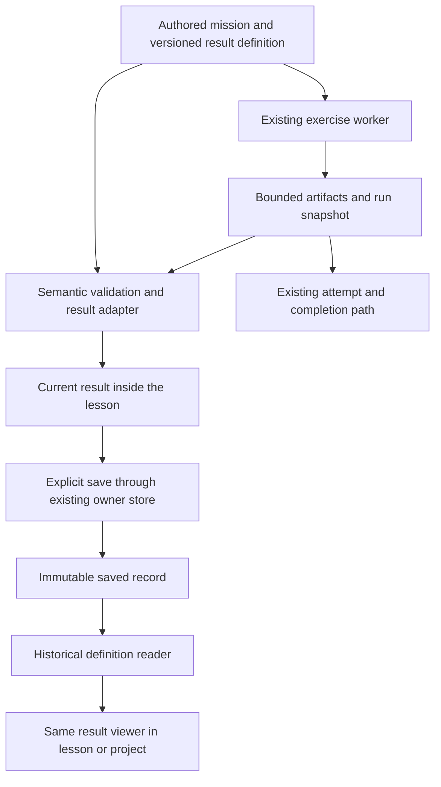

# Story-driven lesson result inspection

Date: November 6, 2026. Status: three-lesson pilot implemented and reviewed locally.
Research baseline: `8550adf771db`. The implementation includes bounded evaluation
capture, semantic validation, immediate result inspection in normalization,
network training, and evaluation, guarded history and restoration, and project
stage integration. Evaluation writes are disabled by default for the reader-first
rollout. The [implementation record](../plans/2026-11-06-result-inspection-design-review.md#implementation-progress-on-november-6)
distinguishes completed validation from remaining release and learner-study work.
The signed-in review completed all five lesson phases across four viewport widths
in both themes, with actual local auth, captured results, history and account
isolation. Human screen-reader review and learner observation remain open.

## Product direction

Each mission should let the learner inspect what their work produced and use
it to answer the crew's current question. The result belongs inside the
lesson's story and task. Its representation follows the work: a sensor chart,
a selected calculation, a model error, a spectrum, or a release record.

Share capture, source labels, selection, history, and recovery across these
views. Preserve the meaning of each lesson's data and output. Keep the
five-section experience, artwork, character voices, earned epilogues, and
interactive Concept activities at the center of the course.

The first implementation should complete the existing evaluation design and
make the already implemented normalization/network explanations available
immediately after a run. Broader lesson coverage follows observed learner
understanding and the lesson-specific contracts below.

## Investigation and evidence

This proposal combines three independent source audits, a review of the
existing desktop and phone screenshots, primary documentation, and small
probes against the installed TensorFlow.js runtime. The supporting records are:

- [Complete Deep Orbit lesson and exercise map](../../design-previews/research/deep-orbit-result-map.md).
- [Current architecture, limits, and runtime probes](../../design-previews/research/result-architecture-audit.md).
- [Story, layout alternatives, and interaction review](../../design-previews/research/story-result-ux-audit.md).

The [five-step design review](../plans/2026-11-06-result-inspection-design-review.md)
develops the implementation sequence. Its second-pass workpapers make the
initial proposal concrete:

- [Evaluation capture and provenance contract](../../design-previews/research/evaluation-result-contract.md).
- [Run, save, restore, and compatibility contract](../../design-previews/research/result-lifecycle-contract.md).
- [Task-specific storyboards](../../design-previews/research/result-experience-storyboards.md).
- [65-exercise capture matrix](../../design-previews/research/result-contract-matrix.json)
  and [lesson design review](../../design-previews/research/lesson-result-design-review.md).

These precise contracts supersede earlier exploratory choices where noted.
The matrix distinguishes source inventory from full pedagogical, runtime,
browser, and learner validation. It also records values that proposed viewers
would need added before they can be rendered honestly.

The [November 2 evaluation review](../plans/2026-11-02-learning-evidence-pilot.md#evaluation-phase-review-2026-11-02)
already defines a useful score-lane inspector and a
[local prototype](../../design-previews/evaluation-inspector/README.md).
Its evaluation-specific capture, mathematical, and canon requirements remain
the implementation contract. This document adds course coverage, shared
current-result placement, historical compatibility, and rollout boundaries.

Important current facts:

| Finding | Design consequence |
| --- | --- |
| The launched course has 56 lessons and 65 unique exercise references. All 65 authored graders declare `recordResult`. | Improve interpretation and integration of existing outputs. A declaration alone does not guarantee capture after an error or establish semantic correctness. |
| Only normalization and the first trained-network exercise have the browser-local saved-run integration. | Current inspection and saved history need separate capabilities. |
| Rich normalization/network explanations appear in saved-run disclosures. Save/history controls precede ordinary live output. | Put the useful current explanation before saving and history. |
| Every lesson already has authored visual investigations or shared teaching surfaces. | Reuse their visual vocabulary while keeping supplied calculations separate from executed code output. |
| Current milestones use different datasets and models. | Show progress in practiced skills without implying one executable model travels through the course. |
| Saved-record validation compares metadata with the current registry. | Version historical readers before changing fixture meanings or scaling the registry. |
| The complete owner store has a 2 MiB ceiling. | Retain selected milestones initially. Course-wide inspection does not imply course-wide full-source storage. |
| Edited training accuracy, changed post-fit weights, and a replaced evaluation method each pass the current nine evaluation checks in pinned-runtime probes. | Copy observations, compare weight state, and measure through retained supported implementations before publishing the result. |
| Some artifacts within one submission come from independent grader probes. | Define compatible result groups before linking selections or comparisons. |
| The wrapper receives completed snapshots but no start/reset events. | Add lifecycle invalidation so delayed preparation cannot resurrect an obsolete result. |

These findings come from current MDX, exercise YAML, and application source.
Older generated learning maps need reconciliation with that source. This
investigation does not establish new production deployment, learner outcomes,
or a current complete-browser pass. Native browser access failed during this
session, so visual review used the existing captured screenshots. Their
earlier verification remains separately documented in the prototype README.

## Story and learning contract

Every authored result definition must answer these questions before release:

1. What does the crew need to find out in this mission?
2. Which data does the learner actually use, and where did it come from?
3. What did this action calculate, change, inspect, or decide?
4. Which interaction helps the learner understand that result?
5. What can the result establish, and what remains unresolved?
6. How does the existing next activity or scene continue that work?

Keep scene passages, artwork, and dialogue visible in their intended section
before the related technical work. Preserve the shared story styling and
decorative waveform behavior, including its static reduced-motion version.
The result explanation uses ordinary teaching prose. It does not introduce
a narrator, an AI tutor, or extra character dialogue around every output.

Source labels should follow the actual activity. A label such as `Your run`
identifies the learner's execution, while the nearby sentence names the data: supplied
practice rows, a fictional recording excerpt, a mocked runtime, or external
project data. Keep feature order, units, selected indices, and sample scope
available where they affect interpretation. An axis label must come from
verified metadata. Tensor shape cannot supply its meaning.

Running revealed solution code still produces that learner's run. Preserve
recorded hint/solution exposure beside the result. The run label cannot
establish independent authorship or competence.

The opening two lessons now share twelve fictional recording values. Preserve
their sensor/time ordering. Several later exercises still use explicitly
synthetic practice fixtures. A result viewer must retain those boundaries.
Replacing a fixture with ship data requires coordinated revision of the lesson,
hints, grading, recall, examples, and story. That content work needs its own
review before the new representation can claim continuity. A source label alone
cannot make an unrelated practice task serve the mission. Resolve that content
dependency before expanding inspection into a lesson that breaks the mission
contract.

The crew's authored 94%, sample 7741's 0.518 and unknown true label, the missed
capture, and the finale's last operator-note row remain canon. Learner scores
do not replace those events. Existing versioned choices can change only their
authored follow-up work. A passing check never invents a discovery or resolves
an uncertainty. A weak result can still give the learner useful work to do.

## Learner journey and placement

### Current work in a lesson

Keep the full-width vertical flow. The current result opens after a run and
before history. The exercise verdict remains explicit and separate from the
interpretation of the output. A learner can inspect valid captured values
even when their final diagnosis is incorrect.

```text
Existing section heading
Existing scene, artwork, and dialogue
Crew question and named input source

Your JavaScript
Run controls and actual execution status
Exercise verdict with useful check feedback

Result from this run
One task-specific visual
Selection controls and exact selected values
Short explanation of the operation or decision
Relevant next action or optional investigation question

Save this run     Download this run
Earlier saved runs
Captured details and full values

Existing transfer activity, recall, and earned story continuation
```

This describes reading order. Runtime details and hashes belong in a
disclosure. Required data-source limits remain beside the evidence. During
implementation, keep checks and the main result adjacent, then test their
exact order in the complete editor flow. Avoid rendering the same chart once
as raw output and again as an explanation. The adapted result can expose its
complete raw values in one details disclosure. Unsupported adapters retain
the ordinary safe output view.

After a run, focus remains on the activated control. A nearby `Inspect result`
link can move focus to the result heading when the learner requests it. A
`Return to code` link preserves the draft, selected item, and result. These
anchors address long phone pages without adding fixed panels or a sixth
lesson section.

### Returning to earlier work

Building DEEP SCAN remains a return surface. Within each existing pilot stage,
show one compact entry with its source, run date, a useful result summary,
and `Inspect saved run`. Keep browser-local saved output and server practice
history visibly distinct inside that stage. Preserve their existing meanings.

The lesson and project page use the same decoded result and viewer. The
project page supplies different surrounding navigation. Guests retain their
in-lesson saved runs because the project dashboard requires sign-in. No guest
save should send the learner into an account-only destination.

Use `Saved run` for one retained record and `Earlier saved run` / `Latest
saved run` for two. The internal first/latest slots describe successful save
order. Deleting first promotes latest. Neither slot establishes the first
attempt, the best model, or independent performance. The timestamp is the run's
completion time, so label it `Run from ...`. Restoring saved code remains
explicit and preserves the newer draft. It does not execute code or recreate
model weights.

## Layout alternatives and visual decisions

| Alternative | Benefit | Cost and decision |
| --- | --- | --- |
| Inline full-width result | Keeps scene, work, evidence, and next action in one reading flow. Supports phone layouts and existing lesson CSS. | Adds vertical length. Select, with one open current result, concise primary copy, explicit anchors, and collapsed history. |
| Persistent editor/result split | Makes edit/result comparison closer on a wide display. | Squeezes code and explanation, reverses the shared Deep Orbit layout, and complicates phone reading order. Defer. Small comparisons inside an activity can still use space purposefully. |
| Project-first inspection | Makes accumulated work easy to revisit. | Adds a navigation detour after every run and excludes the current guest path. Use only for returning to saved work. |

The memorable element should be the learner's inspectable work. Keep the
existing world palette, original scene art, Inter type, square controls, and
shared spacing. Introducing unrelated visual styling would weaken the world.

The compact token system reuses existing CSS variables:

| Role | Token | Deep Orbit dark | Deep Orbit light |
| --- | --- | --- | --- |
| Page | `--tc-bg` | `#181818` | `#f5f5f2` |
| Result surface | `--tc-surface` | `#232323` | `#ffffff` |
| Text | `--tc-text` | `#e0e0e0` | `#1f1f1f` |
| Selection and focus | `--tc-primary` | `#6baa8a` | `#3b6550` |
| World accent | `--tc-accent` | `#a89060` | `#6b5a3b` |
| Incorrect prediction | `--tc-error` | `#fca5a5` | `#b00f0f` |

Use `--tc-border-interactive` for control boundaries. Color accompanies text,
shapes, and focus. Inter handles prose, controls, and chart labels. JetBrains
Mono handles executable code. Preserve the shared responsive lesson scale,
including its 32px section headings, 28px activity headings, 22px desktop body,
and 24px content gaps. Use tabular numbers where alignment helps comparison.
Left-align prose and controls. Retain shared centered captions. Keep prose
lines under roughly 80 characters without squeezing the full-width visual.

The initial generic counts-and-table direction would make evaluation look
like an analytics dashboard. The existing prototype already improves it with
two supplied-class lanes, a fixed boundary, and linked case details. Retain
that choice. Across the course, replace generic statistics with the lesson's
actual object of investigation. Avoid extra cockpit frames, repeated metric
cards, accent bars, decorative labels, and celebratory score animations.

## Representations that fit the lessons

The [56-row map](../../design-previews/research/deep-orbit-result-map.md)
records every launched lesson and all 65 primary/secondary exercises. It
separates current captured output from the proposed interaction and its limits.
These families organize that coverage. They are a design vocabulary, not a
commitment to build every renderer in the initial slice.

| Work the learner does | Suitable result interaction | Important boundary |
| --- | --- | --- |
| Arrange sensor readings and tensors | Select a sensor, moment, or cell and follow its value between the recorded array, tensor layout, and chart. | Preserve ordering and labels. Shape alone cannot identify axes. |
| Transform features or calculate a gradient | Select an input/feature/step and inspect captured operands, operation, and output together. | Fixed arithmetic can explain the operation. It does not establish a trained model's causal reasoning. |
| Build or train a network | Select a recorded epoch or row, inspect observed settings, and compare scores from the defined model states. | Label sampled histories and training rows. A training trace does not establish held-out performance. |
| Evaluate classifications or anomalies | Filter categories and inspect a case's input, supplied label, score, decision rule, and error. | Preserve full precision for classification. A score or error category cannot prove why the model failed. |
| Process signals | Select a sample, bin, or window and coordinate the captured time/frequency views. | Derive frequencies from the recorded sample rate and transform length. Label excerpts and distinguish supplied waveforms. |
| Work with recurrent state and windows | Select a timestep/window and inspect ordering, state updates, or the recorded prediction. | Preserve chronology and state boundaries. Do not animate an invented live stream. |
| Forecast, filter, or combine models | Inspect predictions and feedback inputs. Add aligned targets and residuals only when observed targets exist. | Label horizons, units, and shared cases. The current sequence-prediction exercise has no future observations and cannot supply an accuracy curve. A selected example cannot represent an entire evaluation set. |
| Calculate attention or weighted blends | Select a query/key pair or head and inspect scores, normalized weights, original values, and actual weighted contributions. | Show the recorded calculation. Attention weights alone do not establish a causal explanation of the model's decision. |
| Load, cache, optimize, or manage resources | Inspect the observed operation sequence and its timings, size, or resource counters. | Name mocks and measurement conditions. A worker fixture is not a device/browser benchmark. |
| Assemble structured reports or language-model pipelines | Select a claim or field and trace its supplied source and validation outcome. | A schema pass cannot certify factual truth or a real provider response. Preserve mocked-provider labels. |
| Document, monitor, export, or rehearse a release | Inspect the actual checklist result, artifact metadata, warning, or rollback trace. | A rehearsal cannot certify production deployment. External project reports keep their self-reported source. |

An ungraded story decision retains its authored consequence. An optional
explanation prompt retains its ungraded status. Keep existing completion and
retrieval rules. Saving, selecting every point, or opening every panel awards
no new lesson credit.

### Evaluation detail

Retain the reviewed full-width plot. Horizontal position is the captured score
from 0 to 1. Two lanes identify supplied calm and flagged labels. Vertical
packing separates overlap and carries no extra measured meaning. Shapes and
text distinguish generated rows from the three hand-written cases only after
row-source validation. Changed-source rows retain observed input positions and
unknown-source markers.
When source meaning is uncertain, use neutral lane labels `Supplied label 0`
and `Supplied label 1`, input-position IDs, and `Input 1` through `Input 3`.
Reserve calm/flagged descriptions for validated fixture meaning.

Category controls highlight a subset while leaving the whole distribution
visible. Label both the highlighted count and the complete available count.
The case selector and Previous/Next controls traverse the selected category
in stable row order. Changing categories preserves the selected case when it
belongs to the new category. Otherwise, select the first case and announce
the scope. `All cases` returns to the full list. Selecting a muted point outside
the category switches to All cases before selecting that point, matching the
prototype. A zero-count category keeps the plot visible, shows a useful empty
message, and disables case navigation.

Start with all cases and the first stable case, matching the existing
prototype. Test whether this hides important errors from novices. An explicit
`Choose a case to inspect` entry and a first-error default with a zero-error
fallback are research alternatives. Each needs the same truthful all-case
coverage and understandable selection state.

Use the strict rule `score > 0.5`. Score 0.5 predicts calm under the installed
TFJS 4.22.0 metric. Apply the comparison before formatting. Keep the threshold
fixed in this captured report. The separate Concept activity already supports
threshold exploration. Repeatedly choosing settings against test results can
leak test information into model selection, as described in
[scikit-learn's evaluation guidance](https://scikit-learn.org/stable/modules/cross_validation.html).

All 43 cases must remain available. Use the four existing artifact slots:
measured scores, run context, 40 generated rows, and three authored rows.
Validate the two tables together. Scores must be finite and within `[0, 1]`.
Confusion counts must sum to the complete set. Require the accuracy derived
from those counts to agree with captured evaluation accuracy to an absolute
tolerance of `1e-6`, verified against the pinned float32 metric. This is a
numeric-consistency tolerance, not an allowance for missing or changed rows.
Incomplete sets withhold whole-run accuracy and expose valid available rows.

Capture aggregate evaluation and individual scores from the same final model
state before any further weight mutation. A selection or reload reads those
captured values. It never reruns prediction or training. Label the final fit-log
accuracy as a training log, since it accumulated during the training process.

Use a guarded synchronous capture phase before registering the grader's checks.
The harness runs `it` callbacks through microtasks and `Promise.all`, so placing
a capture check first does not establish execution order. Snapshot the submitted
diagnosis before any grader invocation of its function. Retain supported
LayersModel evaluation/prediction implementations before learner code runs,
and use them to measure the copied input rows. Compare submitted metrics to
those measurements. This checks value agreement, without proving the learner
called `evaluate()`.

Copy loss and accuracy before fit returns to learner code. The current recorder
copies loss only. For this initial contract, custom callbacks make training-log
provenance unknown because they can edit logs before TFJS History records them.
Copy weights at fit completion and immediately before/after final measurement.
Changed post-fit weights retain useful final-state results with a continuity
warning. A change during measurement prevents a combined metric/case claim.

Runtime-only weight checkpoints use at most 32 tensors and 8,192 copied values
each. The first implementation freezes plain number arrays, retaining exact
float32 values. The assigned 673-parameter model uses 673 numbers per checkpoint,
approximately 5,384 numeric bytes before array overhead. Read model-owned
variables into owned copies without disposing those variables.
These checkpoints never become saved model weights or a restoration mechanism.

Freeze the independent canonical float32 fixture. Accept paired training-row
reordering by complete multiset comparison. The evaluation contract checks
ordered row identity. Keep observed input positions distinct from canonical
case IDs when source checks fail. Preflight the entire artifact bundle before
publication. Missing partitions omit their artifact because wire version 1
rejects empty tables. Missing coverage cannot acquire whole-run summaries.

The explanation can say how the supplied score and decision rule produce a
class. Feature bars show inspected inputs. They are not feature importance.
No waveform can be inferred from three unrelated practice features.

## Proposed system architecture

Reuse the current worker, bounded artifact protocol, exercise snapshot,
owner-scoped store, and project stages. Add explicit semantic adapters between
capture and presentation. Keep raw execution separate from lesson credit.



### Ownership of each responsibility

| Layer | Proposed responsibility | Existing integration |
| --- | --- | --- |
| Authored content | Crew question, data source, activity requirements, representation reference, next investigation, and limits. | Current MDX/YAML and lesson visual specifications. |
| Worker/grader | Copy actual bounded values, verify supported fixture membership and observed fit history, and publish before unrelated diagnosis assertions. | `exercise-runner.ts`, `exercise-artifacts.mjs`, `exercise-fit-recording.mjs`, exercise YAML. |
| Result definition | Stable ID/version, explicit artifact roles, decoder, source contract, viewer family, and retention policy. | Start with a small typed web registry near `learning-evidence-types.ts`. |
| Adapter | Validate semantic identity and completeness, compute deterministic summaries from captured values, and return usable/partial/unavailable states. | Reuse normalization/network parsers and add evaluation validation. |
| Viewer | Render the same decoded record live or saved, with transient selection and text equivalents. | Existing explanations plus the reviewed evaluation plot. |
| Host integration | Place current inspection before save/history, isolate identity changes, and keep completion callbacks independent. | `Exercise`, `LearningEvidenceExercise`, and lesson component resolution. |
| Persistence | Immutable snapshots, bounded first/latest saves, atomic writes, migration, download/delete, and draft-safe restore. | Existing IndexedDB store and draft recovery. |
| Project | One entry per existing pilot stage, entitlement-safe links/source, and distinct local/server history. | Existing project page, pipeline, and evidence components. |

The shared UI package should expose a current-result render slot in the outer
`Exercise`, at the current `ExerciseOutput` position. Bubble the existing typed
snapshot and stale state to that slot. The web host supplies the lesson adapter
and viewer. Restore remains in the existing Sandpack/editor context, with a
single footer slot for Save/history after the current result. A narrowly scoped
bridge can expose the restore action to that footer without remounting the
editor or creating another activity instance. Keep application-owned storage
and authored world semantics out of the UI package. UI already depends on
shared, so shared types must not acquire an import from UI.

The result hook needs idle/running/settled attempt state, its immutable snapshot,
and current source. The first proposal's snapshot-only hook cannot invalidate
an asynchronous capture on reset or run start. Add explicit lifecycle events
while preserving the existing snapshot callback once per accepted completion.
The [lifecycle contract](../../design-previews/research/result-lifecycle-contract.md#a-small-ui-package-contract)
defines that boundary. The outer exercise owns raw attempt state. The web host
owns semantic decoding, one retained useful report, and save preparation.
Keep ordinary output as the fallback, with an explanation when a known adapter
cannot interpret a structurally safe capture.

At a new run, retain at most one earlier useful report collapsed as `Previous
run`. A new valid report replaces it even if the diagnosis check fails. A
failed attempt without useful output leaves it explicitly previous. Reset and
scope changes clear transient reports. Keep saved work untouched.
Move the existing `renderSavedRuns({ currentCode, restore })` hook to the outer
footer instead of creating a second history API.

A small command registration inside the single existing Sandpack provider can
register its restore closure with the active draft key, scope/instance token,
and registration ID. The outer restore wrapper dispatches only while all
identities still match. Cleanup clears only its own registration, so an old
instance cannot remove a newer same-key registration. An unavailable editor
bridge disables restoration. Preserve
the existing stash/refusal behavior and newer-draft recovery. Cover reset,
unmount, account switching, stale closures, and failed preservation explicitly.

The current output and asynchronous snapshot preparation must refer to the
same run identity. Assign a transient run token when execution starts and
invalidate current presentation on owner change, unmount, or a newer run.
A delayed hash/adapter completion must never replace a newer visible run.
An explicitly requested save of run A may finish after run B starts. It can
update A's saved status/history in the same owner scope while B stays current.
Scope changes suppress the previous owner's visible completion messages.
Resolve owner identity synchronously from account/guest scope, independently
of database readiness. Do not allocate a fallback guest identity while history
loads. Reuse existing sequence and transaction guards. Create the persisted
snapshot once per captured token. A later save retry retains that run ID.
Report committed saves/deletes separately from failed history refreshes, and
key pending mutations by their actual kind, run, and owner.

One submission can execute independent grader probes. Its run ID alone does
not establish continuous input or model state. Each definition must declare
compatible artifact groups. Link selections only within a reviewed group.

### Result-definition contract

Use an explicit small registry first. A definition needs:

- Stable definition ID and semantic contract version.
- Full authored world/module/lesson/exercise identity.
- Expected fixture ID/version and source kind, kept separate from observed
  fixture verification.
- Named feature/axis order, units, row identity rules, and excerpt coverage.
- Required artifact roles and role versions, with an allowlisted decoder.
- A suitable viewer and a short task-specific interpretation contract.
- Optional existing project stage and either transient or milestone retention.

Select a renderer through its explicit definition. Current legacy parsers
depend on exact artifact titles and columns. Keep artifact wire version 1
unchanged for the initial slice. Map frozen titles and column schemas to
semantic roles inside versioned adapters, rejecting unexpected structures.
That compatibility mapping cannot infer meaning from a title alone, a slug
substring, or tensor shape. A later wire-level role-ID proposal must coordinate
the worker, host validator, CLI harness, fixtures, and dual readers. It remains
separate from the immediate result viewer and saving work.

### Initial persisted representation

Keep host snapshot schema version 1 as well as artifact wire version 1 for
this bounded release, with the compatible-reader rollout below. The evaluation's Run context artifact uses a fixed-key
table with exactly 38 typed rows and enumerated statuses. It carries definition ID,
semantic version, source-check status, observed fit-history status, recording
capacity status, bounded reason codes, decision rule, diagnosis, and the
required model/fit settings. Its exact key set and field types belong in the
evaluation decoder. Keep it within the existing 40-row/12-column limits.
Machine-readable fields must never be recovered from explanatory prose.
The [evaluation contract](../../design-previews/research/evaluation-result-contract.md)
defines the exact key set, statuses, capture order, independent measurements,
and bounded state comparison. Copied fit logs remain limited by their observed
runtime path. Custom callbacks can alter logs before History records them.
Unsupported paths cannot receive a verified training-history label.

Resolve the initial definition through an explicit exercise/fixture-version
mapping, then verify the context table's definition/version against it. The
new evaluation envelope describes the assigned task. Its `sourceLabel` must
explicitly identify that assignment. Verified-source claims come only from
the validated observed context and matching case data. This prevents automatic
registry metadata from granting an unsupported capture a canonical origin.

Keep existing normalization/network envelope semantics and frozen readers
unchanged. Their absent new provenance fields remain unknown. Persist each
observation once in the context artifact, and derive visible states through
the adapter. A future host schema 2 becomes justified if other consumers need
these fields independently of artifact decoding, or if envelope semantics must
change across the platform. That migration is separate from this slice.

Avoid a schema change across all 65 exercises before the initial contracts
work. When author-facing references become useful, add the reference to both
Velite and the runtime content schema, rebuild generated content, and validate
that the definition exists and matches the owning exercise. Metadata selects
allowlisted behavior. It cannot supply arbitrary components or executable
rendering functions.

### Independent states and trust

Keep execution, graded checks, capture completeness, observed provenance,
recency, storage, and assistance as separate dimensions. They can coexist:
a valid result can accompany a failed diagnosis, a saved record can be stale,
and a high accuracy can include missed anomalies.

| State | Learner-visible behavior |
| --- | --- |
| Before run | Name the useful output the activity will produce. Supplied examples keep their own label. |
| Runtime loading or execution | Show actual status. Keep story and editor visible. Preserve the existing separate runtime/execution budgets. |
| Complete result with failed checks | Show valid measured values and the incorrect verdict together. |
| Partial capture | Name missing coverage and withhold unsupported summaries. Keep valid available values inspectable. |
| Unknown provenance | Describe what was captured and what source/history checks could not establish. Avoid a verified-source label. |
| Observed mismatch | Show the relevant failed check. Do not attach the expected fixture's meaning to mismatched values. |
| Edited code | Keep the result tied to its submitted source. Offer a fresh run. |
| Failed rerun | Show the new failure. Preserve one earlier useful report collapsed as Previous run and keep saved history. A terminated worker may return no partial artifacts. |
| Storage failure | Keep current inspection usable. Explain browser-local recovery limits and offer download. |
| Historical contract | Decode with the original supported definition and label the result historical. |
| Unsupported contract | Explain why history cannot open and skip semantic visualization. Preserve current in-memory work. The initial owner-store recovery policy below limits export and mutation. |
| Identity change | Hide previous-owner results immediately and ignore late work from that scope. |

Validate structural safety before semantic interpretation. Malformed payloads
cannot bypass limits through a partial or unknown state. A structurally valid
partial/unknown record may retain its honest status and be downloaded. Saving
such a record requires an explicitly supported definition and safe decoder.

The fit recorder gives diagnostic observations. It cannot prove arbitrary
learner code never used held-out data. Client-side hashes and checks cannot
become authoritative assessment, public rankings, or mastery claims.
Object identity alone also cannot establish unchanged weights or immutable
training accuracy. Keep fit-completion observations and final-state measurements
separate. Pinned-runtime probes in the evaluation workpaper demonstrate the
current gaps. The proposed repairs still require their own implementation tests.

### Historical compatibility and storage

Keep schema version, result contract version, fixture version, exercise source
hash, and renderer release separate. Presentation-only changes can reuse a
contract. Changes to feature meaning/order, source, units, or captured data
selection/sampling rules need a new semantic contract. Historical labels use
the original metadata. Changing navigation or default selection alone remains
a presentation decision.

Freeze readers for the existing normalization/network records before adding
new definitions. Read old JSON without rewriting it. Migrate through an atomic
successful write with fixtures for legacy records and concurrent tabs. Preserve
unknown assistance/provenance as unknown. Never fill missing observations using
current fixture values.

The initial store keeps its current atomic all-or-nothing validation policy.
Support the exact legacy definitions and the new evaluation definition.
An unknown or corrupt owner envelope must fail visibly without mutation. Do
not add per-record salvage or automatic quarantine to this slice. Preserve
any bounded export already available, keep the current in-memory result usable,
and explain when saved history cannot be opened. A supported snapshot whose
known contract is historical can render through its original decoder. General
recovery of future/invalid records needs a separate design before broader
registry evolution. This keeps current corruption handling honest while
preventing known legacy records from becoming invalid after an ordinary update.

There is no general raw-owner export today. Downloads can preserve a valid
current or previously loaded snapshot. Do not promise export or deletion of
an owner envelope that cannot be validated. Structural failures block the whole
owner. An unrelated hash failure can block mutations even when another
milestone's history opens, because listing hashes the selected milestone while
mutations verify all retained records.

Deploy frozen legacy readers and the new evaluation reader before enabling
evaluation writes. Keep that reader release as the rollback floor. An older
bundle rejects an unknown milestone even under schema 1. Long-lived old tabs
may need reload before history opens. A version check helps only clients that
already include it. Preserve their drafts and fail writes without mutation.
The lifecycle contract specifies the reader-first sequence and alternatives.

Keep current global artifact bounds and the 2 MiB owner limit for the pilot.
At maximum allowed sizes, two saves across all 65 exercises would require
about 40.6 MiB for source and artifacts alone, before JSON/context overhead.
Measure real serialized snapshots before revisiting retention. Use first/latest
saves for the three pilot milestones, and transient inspection for
later lesson families until a retention budget is reviewed. A full owner store
returns a useful failure without deleting earlier work to make space.

Browser storage can be evicted or cleared. State `Saved in this browser`,
including for signed-in accounts, and retain download. Browser quotas and
best-effort eviction vary, as documented by
[MDN](https://developer.mozilla.org/en-US/docs/Web/API/Storage_API/Storage_quotas_and_eviction_criteria).
Keep guest adoption explicit and separate. Account synchronization would need
its own API, RLS, retention, export/deletion, retry/conflict, and access design.
Full-model persistence would also require weight/optimizer compatibility and
a different capacity budget. Both remain separate projects.

## Accessibility, responsiveness, and performance

Use native selectors and buttons for exact selection. Pointer interaction
supplements them. Avoid a tab stop for every plotted point. Give filters
`aria-pressed`, meaningful counts, and an explicit group name. Keep the selected
case, plot emphasis, source, exact values, and explanation coordinated.

Keep a short status region mounted before asynchronous results. Announce
verdicts and concise selected-item changes without moving focus or reading
the whole report. This follows
[W3C's status-message guidance](https://www.w3.org/WAI/WCAG22/Understanding/status-messages.html).
Retain visible correctness wording and meaningful errors.

Provide a summary and full structured values alongside complex visuals.
W3C's [complex-image guidance](https://www.w3.org/WAI/tutorials/images/complex/)
supports short identification plus a detailed text alternative. Do not put a
large table into one `aria-describedby` string. Preserve table semantics and
keyboard access.

At 320px, 390px, 1024px, and 1440px, keep story and explanation in normal reading
order. Check both schemes, enlarged text, and 400% zoom/reflow. Wide value tables
may use a labeled, focusable local scroll region while the surrounding page
reflows, consistent with [W3C's reflow guidance](https://www.w3.org/WAI/WCAG22/Understanding/reflow.html).
Use roomy controls and visible focus without introducing sticky content that
obscures the task or editor.

Selecting a point should only highlight already captured evidence. It should
not retrain, infer again, mutate the record, or animate invented progress.
Honor reduced motion and preserve the existing story treatment. Load each
viewer with the relevant activity, reuse bounded SVG/table primitives, and
keep large raw tables collapsed. Avoid adding a charting framework or runtime
download for the 43-case report. Profile the complete editor/result page before
setting new performance budgets.

## Validation and staged implementation

| Stage | Concrete work | Exit evidence |
| --- | --- | --- |
| A. Result and source correctness | Adopt the exact evaluation contract, immutable fit observations, bounded weight checkpoints, retained measurement methods, independent fixture checks, and synchronous capture before diagnosis. | Reference and plausible wrong answers, mutated history, custom callbacks, changed weights, replaced methods, extra fits, wrong-model history, changed/reordered rows, overflow, partial bundles, strict threshold equality, and metric consistency. A valid model has no required score or error count. |
| B. Immediate inspection | Add a current-result slot. Reuse normalization/network decoders and implement the evaluation viewer using its reviewed prototype. Keep ordinary output fallback. | Full editor/run/check/inspection flow in actual lessons. Wrong diagnosis retains valid output. Stale and failed runs remain truthful. No new credit or automatic reruns. |
| C. Recovery and discovery | Add evaluation to existing owner storage and stage. Freeze historical readers, migrate safely, and consolidate pilot-stage placement. | Save, reload, inspect, download, delete, changed contract, failed write, concurrent tabs, guest/account changes, paid-source access, and restore/newer-draft recovery. |
| D. Learner observation | Use current normalization/network discovery tasks and evaluation interpretation tasks. Revise repeated confusion. | Separate first responses from help, navigation failures from interpretation failures, and supplied prototype records from participant output. |
| E. Representative lesson families | Extend tensor layout and scalar-gradient results, then select one signal, runtime, and structured-report example from the map. | Family-specific semantic tests, complete lesson/story review, and observed comprehension before wider rollout. |
| F. Broader coverage | Apply reviewed families to remaining mapped lessons and secondary exercises. Reconsider selective retention using measured sizes and demand. | Per-lesson source, runtime, browser, and learner evidence recorded separately. No blanket success claim from shared component tests. |

The first implementation remains a bounded extension of the November plan.
Estimate remaining work after the source/protocol spike. Earlier whole-pilot
estimates include completed work and omit some new compatibility findings.
No delivery date or production readiness follows from this investigation.

The highest-risk implementation seams are:

- `packages/ui/src/mdx/exercise.tsx`: render-slot placement, live run identity,
  existing verdict announcements, and unchanged completion callbacks.
- `exercise-runner.ts`, `exercise-fit-recording.mjs`, and `deep-scan-eval.yaml`:
  bounded observed provenance and capture independent of final diagnosis.
- `apps/web/lib/learning-evidence-types.ts`: explicit definitions, observed
  source status, legacy readers, and semantic validation.
- `learning-evidence-store.ts`: owner budget, migration, concurrency, and
  failure atomicity.
- `LearningEvidenceExercise`, saved panels, and project components: one viewer
  for live/saved records, scope changes, entitlement-safe lookup, and recovery.
- Content schemas and MDX partitions: definition ownership and exactly one
  side-effecting activity mount when author-facing references are introduced.

## Research questions and release checks

The [IES learning guide](https://ies.ed.gov/ncee/wwc/PracticeGuide/1) supports
combining graphics with explanation, connecting concrete and abstract
representations, and asking explanatory questions. Shute's
[formative-feedback review](https://myweb.fsu.edu/vshute/pdf/shute%202007_f.pdf)
supports specific task feedback in manageable pieces and documents variation
across tasks and learners. These sources inform the proposed interaction.
They do not establish that this implementation improves learning or retention.

Keep the existing planned discovery round and formal novice pilot distinct.
For evaluation, observe whether learners can:

1. Identify whose run they see and which model/data produced it.
2. Find a missed anomaly or explain a valid zero-error run.
3. Connect the exact score, supplied label, and fixed rule to the decision.
4. Explain why training logs, test scores, and fictional crew results differ.
5. Suggest a relevant next investigation and identify suitable new evidence.
6. Save, find, and restore a record while recognizing the newer draft.

For other families, change the task to the lesson's actual purpose. A tensor
lesson asks learners to trace a reading, a gradient lesson asks them to explain
an update, and a runtime lesson asks what its measurement does and does not
cover. Preserve independent later tasks and delayed checks.

Use the existing proposal's diagnostic rule: two independent instances of the
same consequential confusion in the proposed six-person discovery group
trigger revision and observation with fresh participants. This rule guides
diagnosis. It is not an effectiveness estimate. Recruitment and participant
records retain their existing owner terms and separate authorization.

Before release, inspect the complete story, editor, result, transfer activity,
and epilogue across relevant widths/themes and browser engines. Cover keyboard,
focus, mobile selection, zero/all errors, partial/unknown data, stale results,
storage failures, and account switching. The human screen-reader walkthrough
remains owner-deferred in the current project record. Its absence remains an
explicit evidence gap without blocking this design investigation.

Remaining product uncertainties are default case selection, the amount of
inline explanation, phone travel between code and result, and which later
outputs learners want to revisit. The architecture supports adjusting those
choices without changing captured truth, story canon, or the execution model.

## Investigation verification

The design artifacts pass formatting, local Markdown-link checks, and the
repository's punctuation constraint. At the research baseline, a source comparison confirmed 56/56 MDX
lesson rows, all 65/65 unique exercise references, and 90 result declarations.
The structured matrix retains exact hashes for all lesson and exercise sources.
Its initial treatments are 18 existing outputs, 28 bounded enhancements,
16 capture extensions, two existing saved-stage viewers, and one evaluation
pilot. These are design categories, without a claim that every capture executes.

Pinned TFJS 4.22.0 probes confirmed identity delegation, mutable history and
weight behavior, overridden evaluation behavior, callback ordering, and strict
threshold equality. A 44-count sweep supports the proposed accuracy tolerance.
The lifecycle review ran 37 existing tests across five focused suites. These
checks validate the research findings. The
[implementation record](../plans/2026-11-06-result-inspection-design-review.md#implementation-progress-on-november-6)
now records the capture/decoder regression tests and course compatibility
checks. Complete-browser review and learner acceptance remain subsequent work.

A four-table preflight passed the existing artifact validator with row counts
2, 38, 40, and 3. Its compact JSON used 5,944 UTF-8 bytes without summaries,
within the 64 KiB artifact budget. It combined existing maintainer measurements
with supplied proposed context. That check establishes wire feasibility,
without establishing provenance by itself. The implementation record separately
documents the later actual-capture tests.
